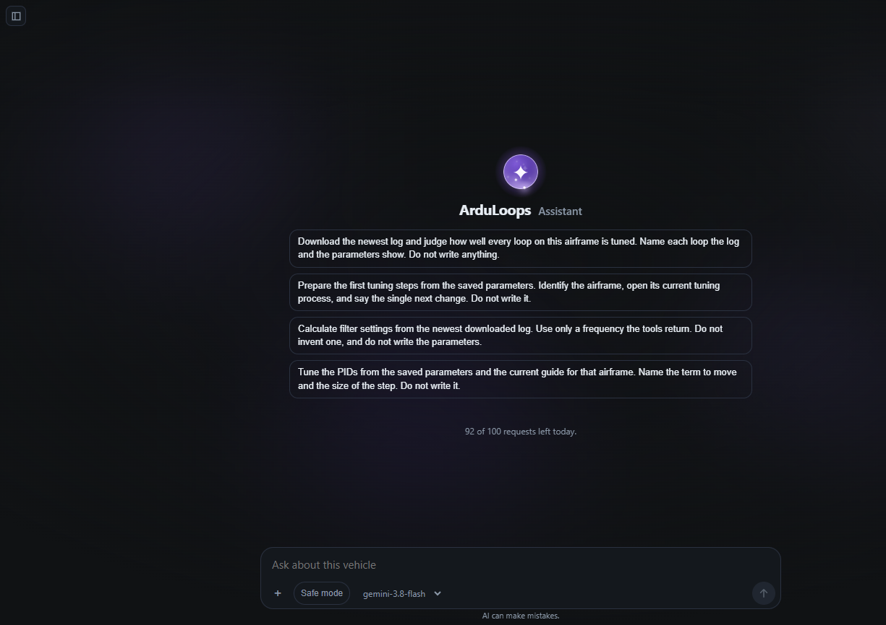
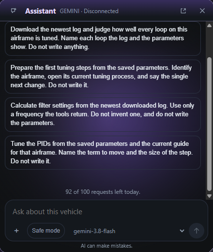

# Assistant

The pane on the right answers questions about the vehicle you have linked. It can read the parameters, the status text, a DataFlash log, the Lua files, and the ArduPilot docs. When an answer quotes a number, that number came back from a tool. It does not send you to Mission Planner or another ground station to finish the job.

A new chat opens on starter topics for this airframe. Nothing is sent until you pick one or type your own.

On the loops page the same chat sits in a small window, so the stand stays visible.

A write stops on a card. You see the old value and the new one, and nothing is sent until you confirm. [Audit](audit.md) keeps the result. Chats stay on this computer. The next message sends the selected context to the provider you picked in Options.

## What it can do

The sessions below all use this same set. A figure in the answer is a figure one of these returned.

It reads parameters on the link, or the last set this app stored when the link is quiet. It can open the official description, range, and units for a name, and it can write a new value. That write is the card above.

It lists the DataFlash logs still on the board and downloads one. For a file already on this computer it can say what the flight contained, how a loop tracked, and draw that series under the reply. A spectrum, or a spectrogram, is drawn only when that picture is part of the answer. Clearing the log chip waits on a card.

It can draw the live link as well. The chart uses MAVLink fields that have already arrived, including a named value a Lua script is publishing, and it can read about the last minute of those fields.

It reads the wiki and a line range from a pinned release. It can look up a board in the official build catalog, queue a custom image, and see the images already downloaded here. A USB flash waits until you confirm it.

It can open a setup wizard and wait while you walk the steps: accelerometer, compass, radio, flight modes, battery, or failsafe. A copter also has motors. A plane also has servos and airspeed. The button only opens the window.

It lists the Lua files on the board and reads one. Writing, deleting, or reloading a script waits on a card, the same way a parameter does. A line you quote in the editor can be asked about on its own.

Mode, arm state, status text, and sensor health come from the link. Connecting, changing mode, arming, disarming, rebooting, and dropping the link use that same card, unless **Safe mode** is on. The vehicle still applies its own pre-arm checks.

## Sessions

These are questions that were actually asked, and what came back.

### Which modes are on the switch?

“Open the flight-mode setup.” The modes wizard opened. It was closed without saving, so the assistant read the parameters instead and listed the six positions already on the board: Circle, Land, RTL, Auto, Loiter, Stabilize, with the switch on channel 5.

Moving the switch to channel 6, and putting it back on 5, each waited on a card. The card names the parameter, the value before, and the value after. **Applied** on the card is the write that landed.

### How did this flight actually track?

“Look at the loop settings on this board.” The log was already on the computer (`imported/c3caffa8346cf708_20260930225855_0.bin`). The answer names the file, the armed stretch, and the modes in it: Alt Hold, PosHold, and Autotune. For each loop it gives the tracking numbers from that file, next to the gains recorded in the same file. Logging health is in the same report, so a sparse stretch is visible before anyone treats the error as a tuning result.

Nothing in that request asked for a write. A later request in another chat did download the newest log and judge rate, angle, altitude, and the horizontal loops the same way.

### The gyros fail when the second battery is plugged in

Before every takeoff the copter calibrates. While that is running, the spotter connects the second battery and prearm reports the gyros as inconsistent. The aim was to calibrate once in the workshop and stop doing it on the pad.

The assistant read the startup calibration and the consistency check in the firmware, then set the options next to each other. The one it marked for this request is to calibrate on a still bench, confirm the offsets were stored, and set `INS_GYR_CAL` so the next power-on keeps those offsets. The other options stay in the answer with what each one gives up. The write, if you take it, still waits on a card.

### Is this copter ready to fly a mission?

“Check the connected drone. Is it ready for missions, and what is missing? Write a test plan.” The answer started from prearm, not from a guess: the battery message was already failing, and the rest of the list came from diagnostics, status text, and the parameters on the link.

### A downward lidar, so loiter holds height

The rangefinder was already chosen: `RNGFND1_TYPE` 49, address 54, maximum 2.4 m. The ask was to add those, and whatever else loiter needs while the lidar can see the ground. The EKF source set was still GPS. The assistant read the live parameters and the docs, then wrote the rangefinder and the source change. A reboot was part of the same session, and it waited for confirmation like any other write.

### What Lua is on the board?

“Read the scripts. Which ones are there?” It listed the files on the vehicle and opened the ones the question needed. A quoted line in the editor can be asked about on its own (“What does this line do?”), and the live value that script publishes can be drawn under the reply.

## Account

Open **Options → AI assistant**.

**Sign in with Google** uses an ArduLoops Cloud account. The row shows how many requests are left today. **ArduLoops Cloud** opens the account page. A document the assistant saves comes back as a link on that turn.

**Use my own key** is the other path. The providers are Gemini, OpenAI, Anthropic, and xAI. **Check** stores the key after the provider answers. **Remove** clears it. **Disabled** turns the model off.

Without a signed-in account or a checked key, the pane has nothing to call.
