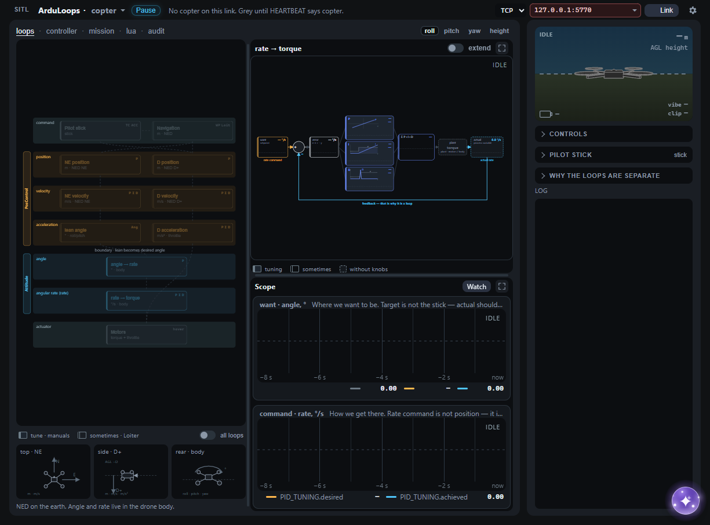
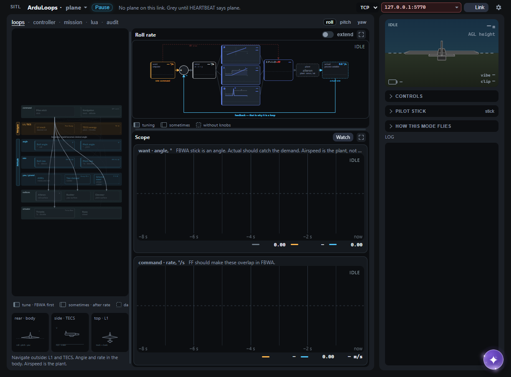

# Loops

After the heartbeat, copter and plane share one page. The map is on the left. The card you select becomes a scheme at the top right, and the traces for that card sit under it. Drag a gutter to give one pane more room. The layout stays where you left it.

**Pause**, next to the title, freezes the picture. MAVLink keeps running, and the stand keeps about a minute of samples, so a longer plot window already has history when you select it. The window itself is 8, 15, 30, or 60 seconds, under **Options**.

On a narrow screen the sticks, modes, knobs, and the notes on the scheme fold away. The log under them keeps the height it had.

`?frame=plane` or `?frame=copter` opens that shell before a vehicle is linked. The **View** menu in the header does the same for Home, Copter, and Plane.

Which live fields each card can actually see is listed in [scope-inventory.md](scope-inventory.md). If the wiki and a card disagree, follow the wiki.

## Copter

The map is the position controller outside and attitude inside. A dimmed block is one this mode is not closing. **All loops** sits on the map.

The scheme is the card you picked: rate and angle are AC_PID, height and position are PosControl P or PID. One rate block serves roll, pitch, yaw, and height, so the axis buttons switch which one you are looking at. Expand the pane when you want the formula and the extra knobs.

Traces follow any block this mode closes. Custom Watch can add a live field that has arrived.

Rate is tuned in Stabilize. **Wool**, **Stock**, and **Sharp** on the stand are a feel you can put on the rate loop. They are a starting point on the bench, and they are not a tuning procedure.

The gains you will meet here are `ATC_*` and `PSC_*`.

Wiki: [First Time Setup](https://ardupilot.org/copter/docs/initial-setup.html) · [Tuning Process](https://ardupilot.org/copter/docs/tuning-process-instructions.html)

## Plane

The map is L1 and TECS on the outside, then roll and pitch as two separate cards, the yaw damper from AHRS roll, ground steering, and the surfaces: throttle, nose, aileron, elevator, rudder. An empty map draws the path the current mode is flying.

The scheme matches the card. Rate is PID plus feedforward. L1 turns a track into a bank. TECS turns energy into pitch and throttle. Click a TECS block on the expanded scheme to see the extra limits.

Traces follow any block this mode closes. Rate comes from `PID_TUNING`. Angle is `nav_roll` or `nav_pitch` against `ATTITUDE`.

Inner loops are tuned in FBWA. Pitch numbers are independent of roll.

The gains you will meet here are `RLL_*`, `PTCH_*`, `YAW2SRV_*`, `NAVL1_*`, `TECS_*`, and `STEER2SRV_*`.

Wiki: [First Time Setup](https://ardupilot.org/plane/docs/first-time-setup.html) · [Tuning Quickstart](https://ardupilot.org/plane/docs/tuning-quickstart.html) · [Roll, pitch, and yaw](https://ardupilot.org/plane/docs/new-roll-and-pitch-tuning.html) · [TECS](https://ardupilot.org/plane/docs/tecs-total-energy-control-system-for-speed-height-tuning-guide.html) · [L1](https://ardupilot.org/plane/docs/navigation-tuning.html) · [Ground steering](https://ardupilot.org/plane/docs/tuning-ground-steering-for-a-plane.html)
