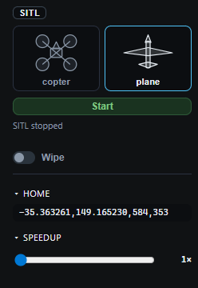

# SITL

**SITL** in the header opens a rail on the left. Pick a copter or a plane and press **Start**. The app then links `tcpout:127.0.0.1:5770`.



What **Start** launches depends on the machine:

| OS | What runs |
| --- | --- |
| Windows | The Mission Planner SITL build, downloaded the first time |
| Linux x86_64 | `arducopter` or `arduplane`, downloaded the first time |
| macOS | The SITL binaries packed into the release (`Copter-4.7.0`, built in GitHub Actions) |

A Mac build made without `scripts/build-sitl-macos.sh` has no binary to launch. In-app SITL is not built for Linux on ARM. The Android app only links to a vehicle that is already running.

While SITL is up, **Start** becomes **Stop**. **Pause** and **Reset** sit next to the speed-up. Wind, GPS, a radio failure, the motors, and the IMU are `SIM_*` parameters. **Reset** puts those back to the values from the start of the link.

One TCP port takes one ground station. If the browser app is already on 5770, the desktop app needs another port, or the other way around.

## SITL you start yourself

Build the tree first: [Setting up the build environment](https://ardupilot.org/dev/docs/building-the-code.html). If ArduLoops is the only ground station, start without MAVProxy:

```bash
cd ~/ardupilot
python3 Tools/autotest/sim_vehicle.py -v ArduCopter --no-mavproxy
# or:  -v ArduPlane --no-mavproxy
```

Link `tcpout:127.0.0.1:5760`. The wiki default (`--map --console`) starts MAVProxy, and ArduLoops then usually wants `tcpout:127.0.0.1:5763`. If that port is taken, try `5762`.

On Windows, follow [SITL on WSL](https://ardupilot.org/dev/docs/sitl-on-windows-wsl.html). WSL2 usually publishes port 5760 on the Windows side. If Link fails, use the address from `hostname -I` inside WSL. An `--out` aimed at `127.0.0.1` stays inside WSL. Use the Windows host address, or `--out udpbcast:0.0.0.0:14550`.
